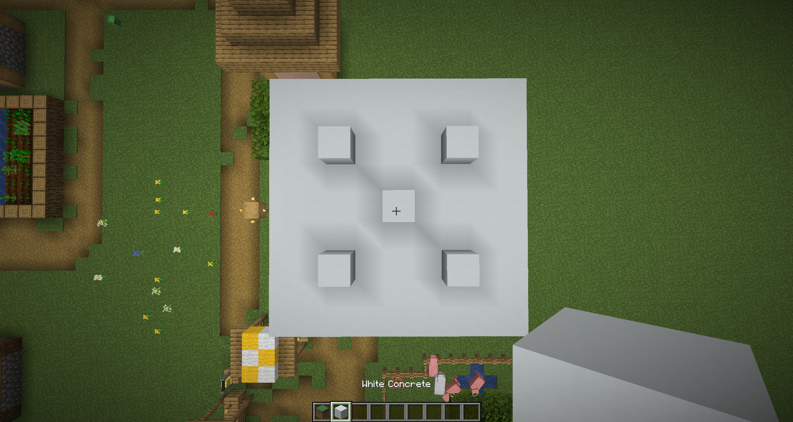
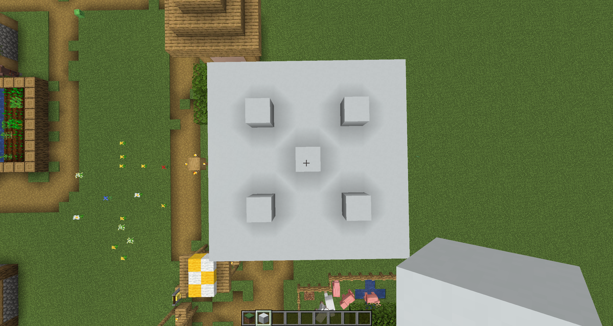

# fix mojang's stupid ass ambient occlusion mesh generator they're dumb

Or fmsaaomgtd for short. Download from the releases page.

Fixes [this bug](https://bugs.mojang.com/browse/MC/issues/MC-138211).

So this:

becomes this:

